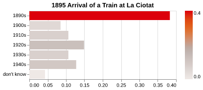
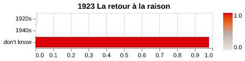
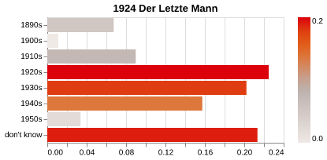
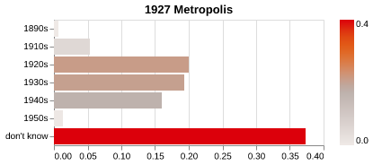
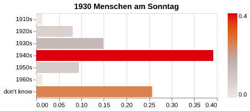
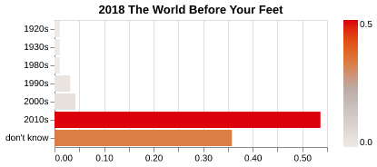

# Fashion Epoch Detection

Inspired by a provocation from the recent FIAF Summer School, this repository facilitates the automatic detection of approximate time period based on clothing fashion visible in a film. The processing model is `qwen3.8` run locally via [Ollama](https://ollama.com/). The pipeline is tested on a minimally resourced machine running Ubuntu 24.04 LTS.

**Deployment**

The pipeline is intended to be run with [uv](https://docs.astral.sh/uv/), and [FFmpeg](https://ffmpeg.org/) and [Ollama](https://ollama.com/) are also system prerequisites. To process a video file, place it under a `media` subdirectory. My initial testing file has been the 50-second Lumiere film [L'Arrivée d'un train en gare de La Ciotat](https://en.wikipedia.org/wiki/L%27Arriv%C3%A9e_d%27un_train_en_gare_de_La_Ciotat) from 1895. Processing occurs on single frames which FFmpeg generates from the video file, the `-vf fps=1` section of that command can be toggled for granularity of one frame per second, one per minute, or whatever is a good balance between a good sample set and tolerance for processing time.

Once the media file has been placed in the appropriate location, the pipeline can be run with `uv run main.py`.

The prompt to Ollama is specifically requesting that the film is dated based on clothing fashion, although it could easily be rephrased to analyse some other attribute (e.g. car models, hairstyles). This process was designed specifically with actuality footage in mind, so accepted values are only between the 1880s and 2020s. It would be interesting to test how it performs with costuming meant to invoke another period. Another possibility worth exploring is whether the LLM is “cheating” by recognising the film and determining the time period by other means. Lastly, the process also assumes homogenous footage - edited together footage from different periods would obviously result in diverse results.

**Examples**

[L'Arrivée d'un train en gare de La Ciotat](https://en.wikipedia.org/wiki/L%27Arriv%C3%A9e_d%27un_train_en_gare_de_La_Ciotat) [1895]

       

[Le Retour à la raison](https://en.wikipedia.org/wiki/Le_Retour_%C3%A0_la_raison) [1923]

[Der letzte Mann](https://en.wikipedia.org/wiki/The_Last_Laugh_(1924_film)) [1924]

[Metropolis](https://en.wikipedia.org/wiki/Metropolis_(1927_film)) [1927]

[Menschen am Sonntag](https://en.wikipedia.org/wiki/People_on_Sunday) [1930]

[The World Before Your Feet](https://en.wikipedia.org/wiki/The_World_Before_Your_Feet) [2018]

`L'Arrivée d'un train en gare de La Ciotat` and `The World Before Your Feet` return strong results, likely assisted by visible clothing appearing in a large percentage of both films. `Le Retour à la raison` is also the expected result, as it is an abstract film in which no clothing is visible. `Der letzte Mann` and `Metropolis` are less successful, possibly owing to a large number of shots not featuring humans, and in the case of `Metropolis`, a mix of non-descipt "worker" uniforms and the imagined fashion of the future. 

`Menschen am Sonntag` is the most interesting result, there is a high confidence that the film was shot in the 1940s, when in fact it was shot in 1929. It would be interesting to explore why specifically this result has occured.

**Licence**

MIT
